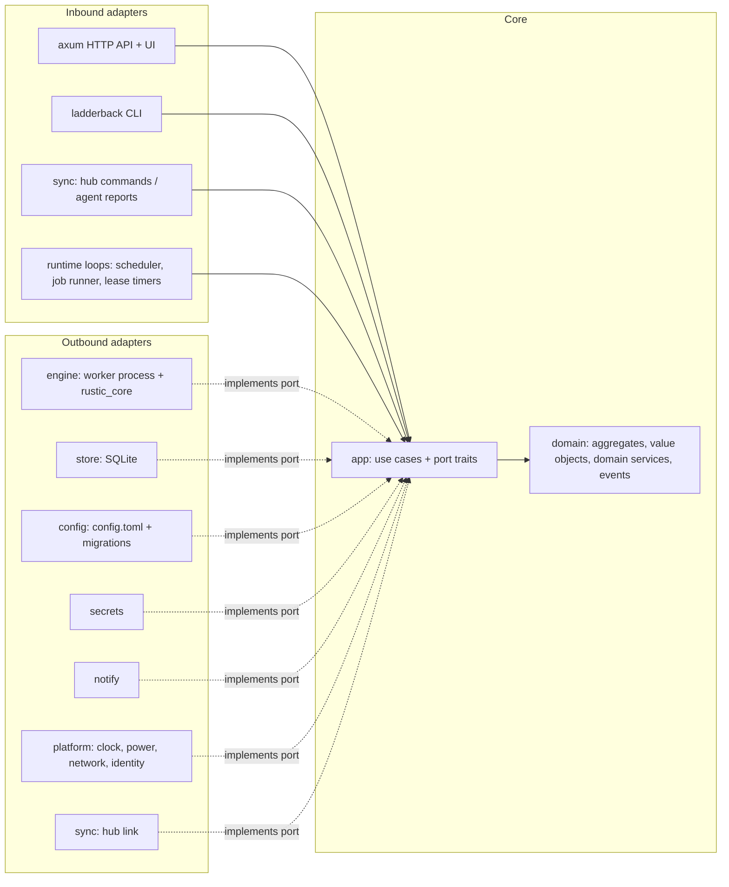

## 3. Architecture

### 3.0 Runtime topology

```
                       ┌──────────────────────── hub machine ─────────────────────────┐
  Browser ──HTTPS──►   │  ladderback serve --hub                                         │
  (Leptos WASM UI)     │   ├─ HTTP API + UI (axum)      ├─ Hub registry (agents, plans,│
                       │   ├─ Scheduler                 │   repo owners)               │
                       │   ├─ Op log (SQLite)           ├─ Maintenance runner          │
                       │   │                            │   (forget/prune/check)       │
                       │   └─ local agent ──spawns──►  ladderback worker ──► repo        │
                       └──────────────▲────────────────────────────────────────────────┘
                                      │ WebSocket (agent dials out, TLS, signed identity)
             ┌────────────────────────┼─────────────────────────┐
     ┌───────┴────────┐       ┌───────┴────────┐        ┌───────┴────────┐
     │ laptop (agent) │       │ server1 (agent)│        │ server2 (agent)│
     │ scheduler      │       │ scheduler      │        │ scheduler      │
     │ op log         │       │ op log         │        │ op log         │
     │ worker ─► repo │       │ worker ─► repo │        │ worker ─► repo │
     └────────────────┘       └────────────────┘        └────────────────┘
```

**One binary, three roles, plus an MCP server on demand:**

| Role | Command | Runs where | Responsibility |
|---|---|---|---|
| **Agent** | `ladderback serve` | every machine | Local config, scheduler, op log, spawning workers, local web UI. Works fully standalone. |
| **Hub** | `ladderback serve --hub` | one machine (often a server) | Everything an agent does, plus an agent registry, aggregated history, the repo ownership registry, maintenance for hub-managed repos, notifications |
| **Worker** | `ladderback worker` (internal) | spawned per operation | Runs exactly one `rustic_core` operation, streams events to stdout, then exits |
| **MCP server** | `ladderback mcp` (started by an MCP client) | wherever the client runs | Lets AI agents and scripts drive a running agent (a hub from M5), or a headless session of their own, over stdio (§4.6) |

Every agent is useful alone. Hub mode is opt-in, and an agent that can't reach the hub keeps backing up on schedule. It stores events in a persistent outbox and replays them when it reconnects.

### 3.1 Domain model (DDD)

Ladderback's hard problems are domain rules, not CRUD: who may prune a repository, which snapshots a policy may delete, when a backup must give up, when a missed run catches up, what a restore may overwrite. Those rules get names, types and tests of their own, independent of rustic, SQLite, axum or the sync protocol.

**Ubiquitous language.** These terms mean exactly this in code, tests, UI copy and docs.

| Term | Meaning |
|---|---|
| Agent | One machine running `ladderback serve`, identified by its agent ID |
| Hub | The agent running `--hub`; holds the registry, ownership and aggregated history |
| Service | An agent the user's **service manager** runs in the background, from login on: a systemd user unit on Linux, a launchd agent on macOS. Its **service file** says what the manager runs: this `ladderback` program's `serve`. `ladderback install-service` writes the file and has the manager start it; `ladderback remove-service` has the manager stop it and removes the file (§12) |
| Build | The program as built from one commit: its **version**, the **commit** (unknown when the build had no `git` to ask), whether tracked files had uncommitted changes (**dirty**), and whether the commit is its version's **release** (the tag `v<version>` names it). Shown as `0.3.0` for a clean build of the release, otherwise as `0.3.0+3f937cf`, or `0.3.0+3f937cf.dirty` with changes (decision 90) |
| Plan | What to back up, from which agent, into which repository, when, and how long to keep it |
| AI agent | A language-model program acting through MCP or the API, such as a coding assistant. Never called an agent alone, which is a machine running Ladderback |
| Configuration change | One typed edit of an agent's configuration: add, change or remove a repository, a plan or a hook, set a plan's retention, claim maintenance. Applied by `AgentConfig`, which keeps its rules; the web UI's plan editor and a proposal both write the configuration through it (§16, decision 89) |
| Proposal | Configuration changes an AI agent (or another API client) submits for a person to confirm, with the AI agent's rationale and the configuration they were based on. It changes nothing until a person approves the whole of it in the web UI, with step-up confirmation and a tick for each command it adds; it can also be rejected, withdrawn or expire, or go **stale** when a change no longer applies to the current configuration. Its summary is written by Ladderback from the changes, never by the agent (§10.5; §16, decision 89) |
| Plan dry run | Walking a draft plan's sources through its source filter to count the files and bytes it would back up and what each exclude removes, never naming a path. It opens no repository, runs no hook and reads only within the **dry-run allowlist**, the folders a person lists in Settings, none by default. Not forget's dry run (`preview_forget`) (§16, decision 89) |
| Repository | A rustic repository, identified by its **repository ID**. An **alias** is one agent's local name for it |
| Location | One place a repository can be reached: a `repository` string, an optional `repo-hot` and the three option sets, with the credentials they hold, and an optional location rule. A repository has one to four, in order; every one must hold the repository's own ID. The password isn't a location's: it opens the repository, whichever location is used. A location's options never apply to another (§6.1; §16, decision 80) |
| Location rule | A condition on the network link that must hold before a location is tried: the link is wired, is Wi-Fi, or is a Wi-Fi network named in a list (or not in one). It chooses which location to try and never makes one trusted; a rule that can't be evaluated doesn't hold (§6.1, §10.6; §16, decision 80) |
| Network link | The network the machine reaches others by: the interface its default route leaves by, as wired, Wi-Fi (with the network's name, when it can be read) or other (§16, decision 80) |
| Probe | A bounded attempt to open one location with its own credentials, in a worker of its own, to learn whether it answers and which repository it holds. The daemon uses the first location, in order, that is eligible and whose probe finds the repository's ID, however soon a later one answers (§5; §16, decisions 80 and 86) |
| Early probe | A probe started at the start of the choice, before the location's turn, beside the others: only for a location whose rule holds and that makes the server prove who it is before it is sent a credential, or sends none (a local path, `rest:https://` with its certificate checked). Its answer waits for every earlier location's; any other location, a plain-HTTP one above all, is probed only in its turn (§10.6; §16, decision 86) |
| Operation | One run of one action (backup, forget, prune, check, restore, …) with a lifecycle: `Queued` → `Running` → `Succeeded` / `SucceededWithWarnings` / `Failed { reason }` / `Cancelled`. A missed deadline is `Failed { reason: DeadlinePassed }` |
| Step | One stage of a running operation as the engine names it: reading the index, reading the snapshots, backing up, finding the data the snapshots use, and the others decision 82 lists. A step has its own progress, and a page shows the step a run is in with how far that step has come. A stage the engine names in words Ladderback doesn't know is no step: the page says the run is working (§4.4; §16, decision 82) |
| Trigger | What started an operation: `schedule`, `manual`, `catch-up`, `retry`, `hub` or `mcp` |
| Operation log (history) | The record of every operation: when it was queued, started and finished, how it ended, what the engine reported, and its first 10,000 warnings with the total. It is written as an operation runs and never needed to run one |
| Persistent queue | The operations the operation log holds as `Queued`, waiting for their turn. It outlives the daemon: when the daemon starts again, a queued backup of a plan the configuration still has, on the repository it was queued for, runs under its own ID, built from the configuration of that moment; any other queued operation, or a backup that can't be built, ends `Failed { reason: DaemonStopped }` (§16, decision 73) |
| Snapshot | A rustic snapshot, read from the repository; never created or edited except through an operation |
| Pack / index | rustic's terms: a pack is a file of the repository's data, written by a backup or a prune; the index lists what each pack holds. Data in a pack no index lists can't be reused by a backup, and a check warns about the pack until a prune removes it |
| Cache slot | One running worker's folder of rustic's cache for one repository: `<cache folder>/<repository ID>/<n>`, the lowest `n` no other running worker of that repository holds. The worker holds it with an exclusive lock while it runs, so no two workers share one, and the next operation on the repository reads the index, the snapshots and the tree packs from it instead of from the repository. Nothing in it is needed: a lost cache is read again, and each time it starts the daemon removes the slots no worker will use again (§4.1, §16 decision 61) |
| Snapshot host | The host name a snapshot records: its plan's `host`, else the agent's `hostname`, else the machine's own name, which rustic chooses |
| Snapshot time | When a snapshot was taken, with the offset of the clock that took it (`2026-11-10 23:30:00-06:00`). A calendar retention rule counts the snapshot on that clock's hour, day, week, month and year, wherever the forget runs (§16, decision 56) |
| Other host | The host a snapshot records, in a repository this agent maintains, when the snapshot came from another machine: this agent didn't tag it, and either another agent tagged it in the last 30 days (or later), whatever host it records, since two machines can share one name, or its host is none of this agent's: not the machine's own name, the agent's `hostname`, or any plan's `host`. A snapshot this agent tagged is this host's under any name, as one made before the machine was renamed. Its snapshots suggest that another machine writes to the repository and may maintain it too (§7.3; §16, decision 62) |
| Source filter | What a plan leaves out of its backup: glob patterns, glob files, ignore files such as `.gitignore`, marker files, extended attributes and other file systems (`SourceFilter`, §6.1). rustic reads a glob with a slash in the middle from the root of the file system; one written from a source reaches none and is a never-matching glob (`NeverMatchingGlob`, warned of as `glob-never-matches`, #510) |
| Plan tags | `ladderback-plan:<id>` and `ladderback-agent:<id>`; they make a snapshot **managed** by a plan |
| Unmanaged group | Untagged snapshots, grouped by the repository's `group-by` |
| Orphaned group | Tagged snapshots whose plan or agent no longer exists |
| Adopt | Retag an unmanaged or orphaned group into a plan |
| Maintenance owner | The single party that runs forget, prune and check for a repository |
| Claim / Grant / Lease | An agent's request to own maintenance; the hub's acceptance; the time-limited, epoch-numbered form of that acceptance |
| Deadline | The latest time a backup may write its snapshot (I3) |
| Prune margin | 1 h + the longest recorded prune on that repository |
| Catch-up | One run in place of any number of runs missed while the agent was off or asleep |
| Next run | When a plan runs next: the schedule's next moment after the last run started (a cron expression's on the wall clock of its zone, or an `every` interval in real time), plus jitter; planned when a run starts and kept while the agent is away (§5) |
| Jitter | How far after its moment a run may be put, so that machines on one schedule don't start at once; never as far as the schedule's following moment |
| Wake | The machine waking from sleep, or its clock set forward: wall-clock time ran more than 2 min ahead of monotonic time between two samples of the clocks 30 s apart. A run missed meanwhile can catch up, and a catch-up run after a wake first waits up to 2 min for the network (§5) |
| Overlap policy | What a plan does when its next run comes due while its last run is still going (running, or waiting in the persistent queue): `skip` it (the default) or `queue` it to start once the last one ends (`Overlap`, §5). A plan runs one backup at a time and never has two runs waiting |
| Concurrency limit | How many backups the agent runs at once, across all its plans: its `concurrency`, 1 unless the configuration says otherwise. A backup beyond it waits in the persistent queue for a running one to end (`BackupQueue`, §5) |
| Retry | A backup a plan's `retry` policy runs again after a backup the schedule started failed: at most `attempts` of them, the first `backoff` after the failure and each after twice the wait before it, at most 1 h. A **series** of retries stops at the plan's next scheduled run, when its attempts are spent, or at a success or a cancel; a retry is skipped while a run of its plan is going. A backup a person or another program asked for is never retried (`RetrySchedule`, §5; §16, decision 76) |
| Notification rule | Which **events** an agent tells, for which plans (all when it names none), and the **channel** it tells them to: `events → channel` (§11). An event is a fact Execution reports, named as `backup.failed` |
| Channel | Where a notification goes: a webhook, an ntfy topic or a healthchecks check, by its URL. The URL, and the token or password it signs in with, are secrets, read only when a notification is sent |
| Template | A rule's own text for its messages, with placeholders for the event's facts (`{plan}`, `{code}`, …) and nothing else, so it can't hold a secret (I4). Without one, the message is the catalog's text in the agent's locale |
| Step-up confirmation | Re-entering the password (or, when auth is off, typing the snapshot's or the proposal's short ID) before a restore, a download or approving a proposal |
| Admin password | The one password that signs in to an agent's web UI and API. Set with `ladderback set-password`, at the terminal or from standard input; only its argon2id hash is kept (§10.1) |
| Sign-in | Asking for the admin password before the web UI and API answer. **On** while an admin password is set, which the daemon decides when it starts; **off** otherwise, and then anyone who can reach the agent can use it: anyone on this machine on loopback, anyone who reaches the address on the network, where the agent and every page warn so (§10.1) |
| Exposure | Who can reach an agent at the address it listens on: this machine, on a loopback address, or **the network**, on any other, which needs an `--allowed-host` (§10.1) |
| Session | What a sign-in starts: a cookie and the CSRF token its changed requests carry. It ends at sign-out, 12 hours after its last **use**, 30 days after it started, or when the admin password is set anew |
| Background read | A request the web UI sends on its own, not because a person did something: a refresh after an event, opening the events stream. It never uses a session, so a page left open doesn't keep one alive (§10.1) |

**Bounded contexts.**

| Context | Kind | Aggregates and domain services | Rules it protects |
|---|---|---|---|
| **Shared kernel** | — | `RepositoryId`, `AgentId`, `PlanId`, `OperationId`, `SnapshotRef { id, time, host, label, paths, tags }`, `Timestamp` | Used by every context; changes need agreement across all of them |
| **Planning** | Core | `AgentConfig` (root; owns `Plan` and `RepositoryConfig` entities; its configuration changes are its methods), `Proposal` (root; base configuration hash, changes, rationale, status, expiry), value objects `Schedule`, `RetentionPolicy`, `SourceFilter`, `Hooks`, `RetryPolicy`, `SecretRef`, `Location`, `LocationRule`, `ConfigChange` | Plan IDs unique per agent; a plan names an existing repository alias; schedules and retention validate; a repository has one to four locations, each with its own settings and none inheriting another's; a proposal changes nothing until approved, names secret sources never values, and is approved whole, against the diff that was shown |
| **Execution** | Core | `Operation` (root; one run's lifecycle), `PlanSchedule` (root; per plan: `next_run`, `last_success`, active operation, retry attempt), domain services `NextRun` (cron, interval, jitter, time zone, catch-up), `Deadline`, `RetrySchedule`, `WakeDetector` (wall-clock vs monotonic samples) | Valid lifecycle transitions; catch-up collapses missed runs; overlap policy; deadline (I3); retries stop at the next scheduled run |
| **Maintenance** | Core | `RepositoryOwnership` (root; claims, grant, lease, epoch; the "no other agent uses this repo" facts are passed in by the use case), domain services `ForgetSelection` (managed / orphaned / unmanaged partition and the delete list), `PruneGuard` | One owner (I1); never instant delete (I2); forget only touches managed snapshots (I6); serialized maintenance (I7, enforced atomically by the store) |
| **Restore** | Supporting | `RestoreRequest` (root), `RestorePolicy` | New folder by default; in-place only from the agent's own UI; hub restores need `allow-hub-restore`; step-up confirmation |
| **Fleet** | Supporting | `Agent` (root; identity, hostname), `PairingToken` (single use, TTL), `HostnameRegistry` domain service | Unique hostnames; tokens used once; re-pairing reuses identity |
| **Profile interop** | Supporting | Anti-corruption layer only (`adapters/interop`): translates rustic profiles to and from Planning | List replacement, hook order, `[snapshot-filter]` export rules (§6.2) |
| **Secrets** | Generic | `SecretRef`, `Redactor` (replaces every resolved secret value, and its common encodings, with `***`) | No secret in logs, templates or sync messages (I4) |
| **Notifications, auth** | Generic | `Notifications` (the channels and the rules, owned by `AgentConfig`), value objects `Channel`, `Rule`, `Template`, `EventKind`; `Sessions` and `SignInWaits` (`domain::access`) | A rule names a channel and plans the configuration has; a channel holds no secret as text and starts no program by a relative path; a template reads only an event's facts (I4). A session ends unused or old, and with a new admin password; a changed request carries its session's CSRF token; failed sign-ins make the next one wait, never lock the admin out |

**Context map.** Planning feeds Execution (plans become operations) and, through the hub, Maintenance (published plans carry retention). Execution emits domain events that Maintenance, notifications and the sync outbox consume. Two anti-corruption layers keep foreign models out: profile interop for rustic's TOML model, and the engine adapter for `rustic_core`'s types. The sync protocol in `api` is the published language between agent and hub; `app` speaks its own `AgentReport` and `HubCommand` types, and the sync adapter translates.

**Domain events and their consumers.**

| Event | Consumed by |
|---|---|
| `OperationQueued`, `OperationStarted`, `OperationFinished { outcome }` | UI live updates, sync outbox, notifications (`backup.*`, `forget.failed`, `prune.failed`, `check.failed`) |
| `SnapshotCreated` | Snapshot catalog refresh |
| `RetryScheduled`, `BackupMissed` | Notifications (`backup.retrying`, `backup.missed`) |
| `CheckFoundErrors` | Notifications (`check.errors`) |
| `PruneRefused`, `ClaimRejected`, `MaintenancePaused { reason }` | Notifications (`prune.refused`, `repo.claim_rejected`, `repo.maintenance_paused`) |
| `MaintenanceGranted`, `LeaseExpired` | Maintenance scheduling on the agent |
| `UnmanagedGroupsFound` | Notifications (`repo.unmanaged_groups`), repository page |
| `AgentPaired`, `AgentWentOffline` | Dashboard; notifications (`agent.offline`) |

The sync outbox (§7.2) persists the events the hub needs.

**Retention evaluation stays in rustic.** `ForgetSelection` decides *which* snapshots each policy applies to; applying `keep-*` rules to a group is delegated to the `Retention` port, implemented with rustic's own `ForgetGroups`, so Ladderback never reimplements retention. The export golden test (§6.2) checks the two agree. A calendar rule counts each snapshot on the calendar of its own snapshot time, as rustic does, so the evaluation reads the repository's snapshot files, which carry the offset, never the listing, which carries it only to show it (§16, decision 56).

**Outside input is parsed once, where it enters.** Text from outside the process (`config.toml`, HTTP requests, imported profiles, worker output, sync messages) becomes domain types in the adapter, or the `api` type, that receives it. `RepositoryAlias::parse`, `PlanId::parse`, `RepositoryId::parse` and the other value objects return either a value that keeps its rules or an error the adapter reports. `domain` and `app` take those types, never the raw string, and don't check them again. A type that can't hold an invalid value is preferred to a check plus the test that proves it: an enum for a closed set of states (`OperationStatus`), and a newtype with a private field and a `parse` constructor for a constrained value, with no public way around its rules.

### 3.2 Code architecture: hexagonal, with a DDD core

Ladderback's complexity sits at its edges: one set of rules is driven by an HTTP API, a CLI, a scheduler and hub commands, and it drives a rustic engine in a child process, SQLite, a WebSocket, OS keyrings, power and wake signals, notification channels and the clock. Ports and adapters name exactly that, and let every rule be tested with fakes for all of it.

| Option | Verdict |
|---|---|
| **Hexagonal (ports and adapters) around a DDD core** (chosen) | Fits many inbound drivers and many swappable outbound systems. The domain and application crates form two inner rings, as in Onion |
| Clean Architecture | Same dependency rule, but its presenters and interactor/output-port pairs add ceremony with no payoff: the UI is a separate WASM app consuming JSON |
| Onion | Equivalent rings; Hexagonal's port vocabulary describes the many external actors better. The inner split is borrowed from it |
| Layered by technology (v0.2's `daemon` crate holding server, scheduler, store and runner) | Rejected: lease, deadline and forget rules would sit next to axum and sqlx, untestable without them |



**Inbound ports (use cases in `app`).**

- **Agent:** `RunBackup`, `TickScheduler`, `CancelOperation`, `RunMaintenance` (forget, prune, check), `EnforceDeadlines`, `AdoptGroup`, `RequestRestore`, `Download`, `ImportProfile` / `ExportProfile`, `EditConfig`, `ApplyRepoGrants`, read-side queries for the dashboard.
- **Hub:** `PairAgent`, `ReportRepos` (claims), `DecideClaim`, `IngestHeartbeat`, `IngestOpEvents` (and acknowledge), `RenewLeases`, `ExpireLeases`, `MarkAgentOffline`, `ForwardCommand` (run, cancel, restore, fetch log).

Each adapter translates its input, calls one use case, and maps the result; no adapter holds a rule. The long-running loops (scheduler tick, job runner, lease timers, wake checks) are async functions in `app` driven by the `Clock` port; the composition root only spawns them.

**Outbound ports (traits in `app`).**

| Port | Capability | Real adapter | Test double |
|---|---|---|---|
| `Engine` | Repository ID, init, test connection, probe of one location (§16, decision 80), backup, list and delete snapshots, retag (for Adopt), prune, check, restore, ls, stats. `run` returns a `RunningJob`: a stream of `EngineEvent`s plus a `JobControl` whose `stop` ends the job gracefully (SIGTERM, a grace period, then SIGKILL); dropping the `RunningJob` kills the job at once. `dump` returns a byte stream carried on its own pipe, separate from the event stream | Spawns `ladderback worker` (links `rustic_core`) | Scripted fake engine |
| `Retention` | Pure: apply a `RetentionPolicy` to `SnapshotRef`s at a given `now` | `rustic_core::ForgetGroups`, in-process | Small keep-last / keep-within fake; the shared contract suite checks it against the real adapter |
| `OperationStore` | Operations and queue; `try_start` refuses a second running maintenance operation per repo (I7) | sqlx SQLite | In-memory |
| `ScheduleStore`, `SnapshotCatalog`, `Outbox`, `LeaseCache` (agent), `OwnershipRegistry` and `AgentRegistry` (hub) | Persistence | sqlx SQLite | In-memory |
| `ConfigStore` | Load (parsing and migrating old schemas), and atomically save `AgentConfig` | TOML file with version history | In-memory |
| `SecretResolver` | Resolve a `SecretRef` | Command, keyring, file, env | Map-backed fake |
| `Clock` | Wall-clock and monotonic time, `sleep_until` (wall-clock) and `sleep` (monotonic: time asleep doesn't count) | System clocks (`Instant`), tokio timers | Controllable fake clock that fires timers when advanced, and can `suspend` the machine (wall-clock time moves, monotonic time doesn't) |
| `Random` | Jitter, session and CSRF tokens; later UUIDv7 IDs, epochs, pairing tokens | OS randomness | Seeded |
| `AdminPassword` | Check an attempt against the admin password, set a new one, and a fingerprint that tells two kept passwords apart (§10.1) | argon2id hash file in the data dir, mode 0600 | In memory, as typed |
| `Identity` | The agent's Ed25519 key: public key and signing | Key file in the data dir | Fixed test key |
| `PowerSupply` | AC power or battery (§16, decision 63) | `/sys/class/power_supply` on Linux, `pmset -g batt` on macOS | Scripted fake |
| `Network` | Whether the machine is online (§16, decision 63) | `/sys/class/net` on Linux, `scutil --nwi` on macOS | Scripted fake |
| `NetworkLink` | The network link (§3.1): wired, Wi-Fi with its name when it can be read, or other, or why the platform can't say (§16, decision 80) | `/proc/net/route`, `/sys/class/net` and NetworkManager's D-Bus API on Linux; `route`, `networksetup`, `ifconfig` and `system_profiler` run as decision 63 runs its commands, on macOS | Scripted fake |
| `ServiceManager` | Install, start, stop and remove the agent's user service (§12, decision 64) | systemd user unit through `systemctl --user` on Linux, launchd agent through `launchctl` on macOS | In-memory fake |
| `EventPublisher` | Deliver domain events to in-process subscribers (UI, outbox, notifications) | Broadcast channel | Recording fake |
| `Notifier` | Deliver a rendered notification | reqwest, lettre | Recording fake |
| `HubLink` / `AgentLink` | Send `AgentReport`s to the hub / `HubCommand`s to an agent | WebSocket sync | In-memory pair |
| `HookRunner` | Run hook commands with a scrubbed environment | Process spawner | Recording fake |

**Port style.** Ports are object-safe traits used as `Arc<dyn Port>`, written with `#[async_trait]` so their futures are `Send` and use cases can be spawned. One boxed future per port call costs nothing next to the I/O behind it, and the composition root stays readable with a dozen ports. Streams are `futures::stream::BoxStream`. No port signature mentions a tokio, sqlx, axum or rustic type.

**Port contract tests.** For each port, `app` exports a generic contract suite (feature `fakes`). The fake runs it in `app`'s tests, and each adapter crate runs the same suite against its real implementation, so a fake can't drift from reality.

**Dependency rule, enforced in CI.**

- `domain` has no I/O, no async and no ambient time or randomness. It may use `serde`, `uuid` (without `v4`/`v7` features), `jiff` (the workspace dependency turns on `tzdb-bundle-always`, so the build carries the IANA time-zone database and zones resolve on a host with no `tzdata`, such as a minimal container image, and in the browser, which has none; `jiff` reads the system's database first and uses the bundled one only when it finds none, §16 decision 30) and the cron crate `croner` with `default-features = false, features = ["jiff"]` (`chrono` is only croner's default; time goes through `jiff` alone, and `just architecture` bans `chrono` from `domain` and `app`, so a default-features slip fails CI; M0 confirms `jiff` and `croner` build for `wasm32`). Its error types implement `Display` and `Error` by hand: they carry codes and values, never sentences (§8.4).
- `app` depends only on `domain`, `async-trait` and `futures`.
- **Banned crates:** a CI step runs `cargo tree -e normal,build --prefix none` on `domain` (also with `--target wasm32-unknown-unknown`) and on `app`, and fails if `tokio`, `sqlx`, `axum`, `hyper`, `reqwest`, `rustic_core`, `rustic_backend`, `fluent-bundle`, `fluent-langneg`, `unic-langid`, `chrono` or any `icu_*` crate appears. Dev-dependencies are excluded, so tests may use a runtime.
- **Banned calls:** `clippy.toml` `disallowed-methods` / `disallowed-types` in `domain` and `app` forbid `std::fs`, the file-system methods of `std::path::Path`, `std::env`, `std::process`, `std::net`, `SystemTime::now`, `Instant::now`, `jiff::Timestamp::now`, `jiff::Zoned::now`, `Uuid::now_v7` and `rand`. Time and randomness come from `Clock` and `Random`. The two files are kept byte-identical, and the architecture check fails if they differ.
- **wasm build:** CI builds `domain` for `wasm32-unknown-unknown`. This proves the UI can reuse its validation (schedules, retention syntax); purity is enforced by the two checks above, not by the wasm build.
- Adapters depend on `app` and `domain`, never on each other. Only the composition root (`src/main.rs` and its `composition` module) knows every adapter and wires them per role: agent, hub, worker, CLI, MCP. `l10n` is a presentation library outside the rings, used by `web`, `adapters/notify` and the CLI (§8.4).
- The worker binary is an adapter: it maps a `JobSpec` onto `rustic_core` calls and reports events. It makes no policy decisions: deadlines, snapshot IDs to delete and retag targets all arrive in the `JobSpec`. Its watchdog is a thin loop that applies the `Deadline` rule from `domain`.
